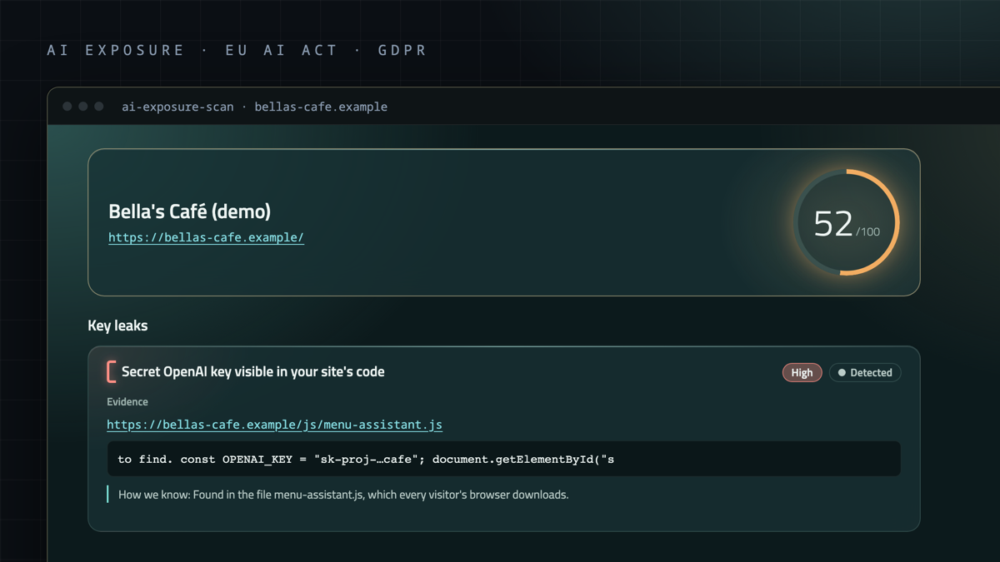
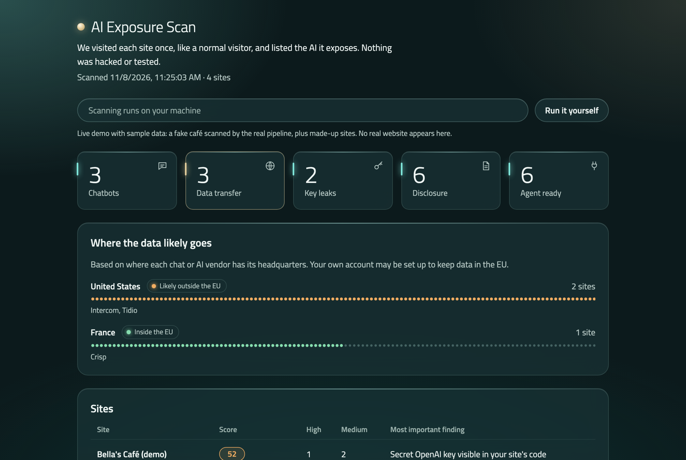
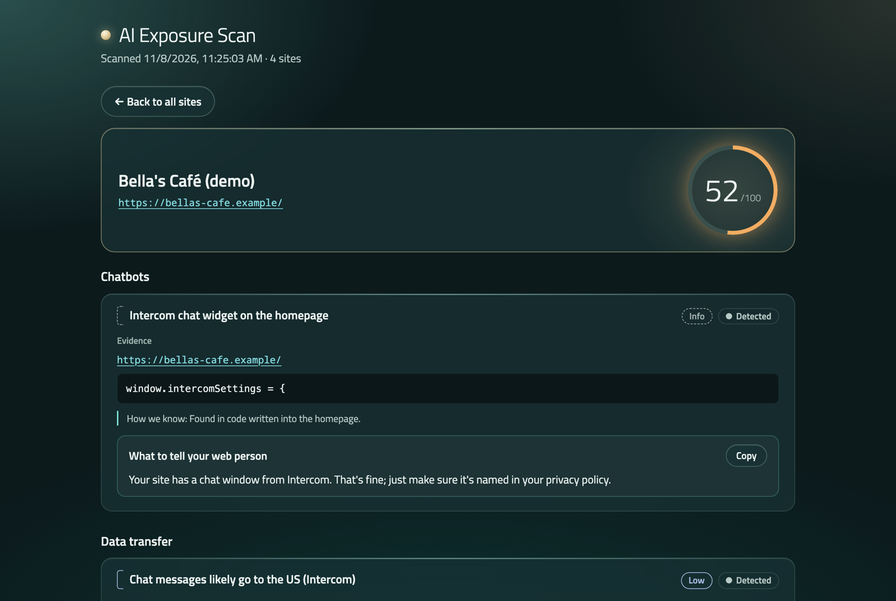
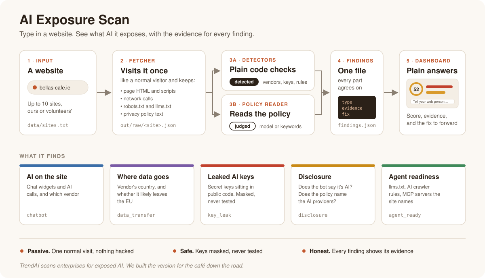
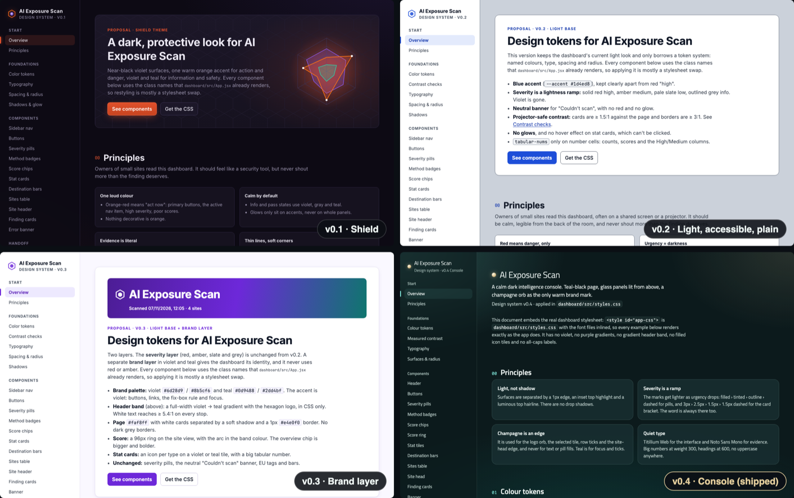
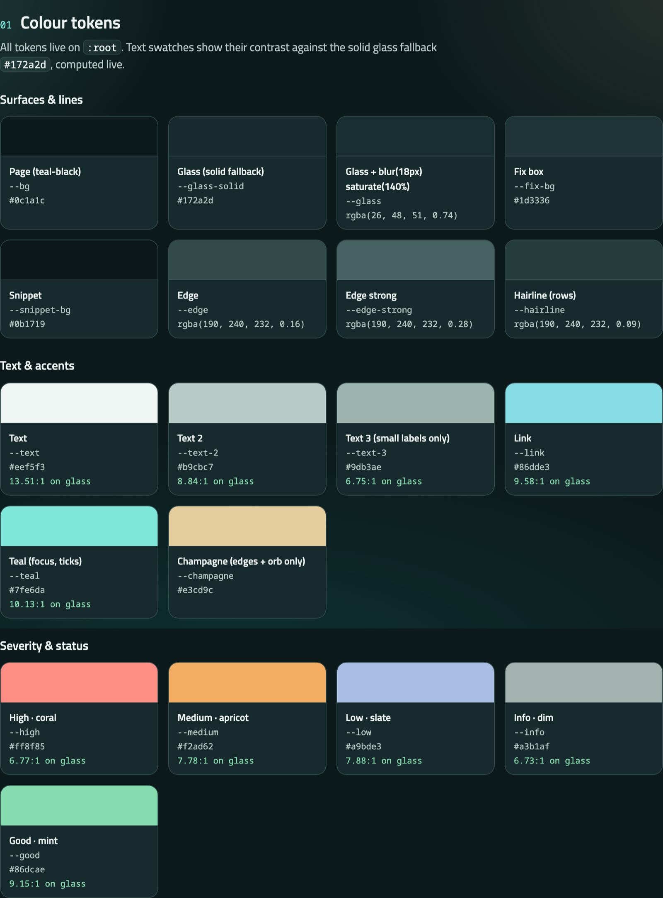
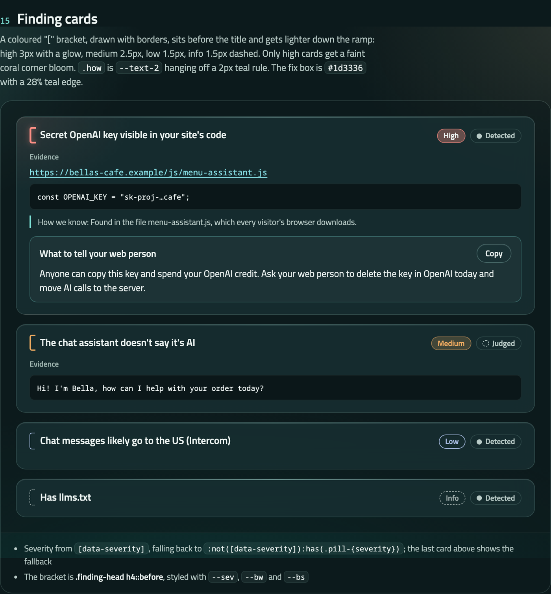

# AI Exposure Scan

**Type in a website. See what AI it exposes, with the evidence.**

[](https://aiwithdiego.github.io/ai-exposure-scan/)
[](https://aiwithdiego.github.io/ai-exposure-scan/design-system.html)
[](https://github.com/AIwithDiego/ai-exposure-scan/actions/workflows/tests.yml)


[](LICENSE)

[](https://aiwithdiego.github.io/ai-exposure-scan/)

A case study. Built in one day with [Devin](https://devin.ai) at the Cognition x Give(a)Go build day, Dublin, 7 Nov 2026.

**[Open the live demo](https://aiwithdiego.github.io/ai-exposure-scan/)** (sample data, nothing real) · **[Open the design system](https://aiwithdiego.github.io/ai-exposure-scan/design-system.html)** · [Run it yourself](#run-it-yourself) and scan any site

**Contents:** [The problem](#the-problem) · [Research](#research) · [What it does](#what-it-does) · [Preparation](#preparation) · [The build](#the-build) · [Design system](#design-system) · [What went wrong](#what-went-wrong) · [What I learned](#what-i-learned) · [Run it yourself](#run-it-yourself)

## The problem

Small businesses have AI on their websites and often don't know it. The web person added a chat widget. A plugin calls OpenAI. Sometimes a secret API key is pasted straight into a script that every visitor downloads.

That carries real risk for the owner:

- **A leaked key** lets anyone spend their AI credit.
- **Chat messages** typed into a widget from a US vendor likely leave the EU.
- **The EU AI Act (Art. 50)** says people must be told when they're talking to an AI. Most café chatbots introduce themselves as "Bella".
- **The privacy policy** rarely names the AI providers the site sends data to.

Big companies pay for outside-in scans that find this. The café down the road, the dentist and the local shop have nothing, and they couldn't read an enterprise security report if they had one.

> TrendAI scans enterprises for exposed AI. We built the version for the café down the road.

## Research

**What already exists.** Two days before the event I went through the AI security vendors. The closest thing to this idea was TrendAI (Trend Micro's enterprise arm, renamed in March 2026). It offers a free domain scan with an exposure rating and has published research on 43,175 exposed AI service instances. It's built for companies with a security team, and so is everything else in that market.

**Who it's for.** The owner of a small business who isn't technical. Every finding has to make sense to someone who doesn't know what JavaScript is, and end in a sentence they can forward to their web person.

**What can honestly be checked from outside.** Only what any browser sees on one normal visit. That one limit shaped the whole product:

- **Passive only:** one page load plus `robots.txt`, `llms.txt` and the privacy policy. No crawling, no probing, no talking to the bot.
- **"Likely", not "does":** we know where a vendor is headquartered, not where a given customer's data is hosted.
- **Detected vs judged:** anything a model decided is labelled as such, and is never shown as fact.
- **Keys masked, never tested:** `sk-proj-AbCd…wxyz`, and no API is ever called with them.

**What I didn't build.** The shortlist also had a ghost-bus tracker, a PHP shell checker, an AI-slop checker, PR receipts, a game and a repo pub quiz. This one won: it's a real problem for real owners, it demos in under a minute, and it splits cleanly into parts that agents can build at the same time.

## What it does

A headless browser visits the site once, like a normal visitor. Plain code checks what it loaded, one optional model step reads the privacy policy, and the dashboard shows each finding with its evidence and what to tell your web person.

| Type | What we look for |
|---|---|
| `chatbot` | AI chat widgets on the site (104 vendors: Intercom, Tidio, Voiceflow, Botpress, Chatbase, GPT embeds...) and who the vendor is |
| `data_transfer` | Where chat data likely goes: vendor country, inside or outside the EU. Which country the site is hosted in (or which CDN edge served it), and which other outside services (analytics, ads, fonts, consent, payments...) the page contacts |
| `key_leak` | AI API keys sitting in public JavaScript (masked, never tested) |
| `disclosure` | Does the site tell people they are talking to AI (EU AI Act Art. 50)? Does the privacy policy name its AI providers? |
| `agent_ready` | `llms.txt`, AI crawler rules in `robots.txt`, MCP endpoints the site names |

The score is 100 minus 25 per high, 10 per medium and 3 per low finding.

<table>
<tr>
<td width="50%"></td>
<td width="50%"></td>
</tr>
<tr>
<td>Every site at a glance, and where its data likely goes.</td>
<td>One site: each finding, its evidence, and what to tell your web person.</td>
</tr>
</table>



```
sites.txt ──> Fetcher ──> out/raw/<site>.json ──> Detectors ─┐
                                              └─> Policy reader ─┴─> out/findings.json ──> Dashboard
```

1. **Fetcher** (`scan/fetcher.py`): Playwright opens each site once and saves the HTML, scripts, network calls, server address, `robots.txt`, `llms.txt` and the privacy policy text.
2. **Detectors** (`scan/detectors.py`): plain code. Vendor list, key patterns, country table, offline IP-to-country lookup, crawler rules.
3. **Policy reader** (`scan/policy.py`): the only model part, and optional. Without an API key it falls back to keyword checks.
4. **Dashboard** (`dashboard/`): React + Vite, one CSS file, no UI library.

## Preparation

The event gave each person $200 of Devin credits and six hours. Devin bills for the time it works, and it burns credits on vague asks, open decisions and retry loops. So I did the deciding before the day, and the day was for building.

The prep pack, written on 5 and 6 Nov:

- **[`docs/brief.md`](docs/brief.md):** the problem, who it's for, what done looks like, the six non-negotiable rules and the stack, marked "decided, don't revisit".
- **[`docs/contract.md`](docs/contract.md):** the two JSON formats every part agrees on (`raw.json` and `findings.json`). This is what let four parts be built at the same time.
- **[`data/fake-findings.json`](data/fake-findings.json)** and **[`fixtures/cafe-demo`](fixtures/cafe-demo):** fake output so the dashboard could start at minute one, and a fake café website with one known finding of every type, for tests and a demo that never fails.
- **[`prompts/`](prompts/):** one self-contained prompt per part, each naming the files to read, the files it owns, what done looks like and when to stop ("stuck twice, stop and report").
- **[`docs/team-plan.md`](docs/team-plan.md)** for teams of 1 to 4, **[`docs/credits.md`](docs/credits.md)** on not burning credits, and **[`docs/pitch.md`](docs/pitch.md)**, the 3-minute demo script.

## The build

One prompt, one Devin session, one PR, with up to three sessions running at once. I reviewed every PR with Claude Code as a second reviewer: it ran the tests on the fixture, scanned my own site and a volunteer's site read-only, and turned the review into one batched message for Devin, so no credits went to back-and-forth chat.

| PR | What landed |
|---|---|
| [#1](https://github.com/AIwithDiego/ai-exposure-scan/pull/1) [#2](https://github.com/AIwithDiego/ai-exposure-scan/pull/2) [#3](https://github.com/AIwithDiego/ai-exposure-scan/pull/3) | Fetcher, detectors and dashboard, built in parallel against the contract and fake data |
| [#4](https://github.com/AIwithDiego/ai-exposure-scan/pull/4) | Policy reader, with a model path and a keyword fallback |
| [#5](https://github.com/AIwithDiego/ai-exposure-scan/pull/5) | Everything connected end to end: one command from site list to dashboard |
| [#6](https://github.com/AIwithDiego/ai-exposure-scan/pull/6) | The design system, four versions (below) |
| [#7](https://github.com/AIwithDiego/ai-exposure-scan/pull/7) | Demo polish: plainer copy, a "how we know" line on every finding, site names |
| [#9](https://github.com/AIwithDiego/ai-exposure-scan/pull/9) | Fixes from the first scans of real sites |
| [#10](https://github.com/AIwithDiego/ai-exposure-scan/pull/10) | A scan box in the dashboard, so it works on any website, not just a list |
| [#11](https://github.com/AIwithDiego/ai-exposure-scan/pull/11) | Hosting country and the outside services each page contacts |
| [#12](https://github.com/AIwithDiego/ai-exposure-scan/pull/12) | Chatbot vendors expanded from 19 to 104, with stricter matching |

## Design system

**[Open the live design system](https://aiwithdiego.github.io/ai-exposure-scan/design-system.html)** · source: [`docs/design-system.html`](docs/design-system.html)

### How it got there



The brief for the look was hard: a security tool that a café owner trusts, that stays calm instead of alarming, that reads on a washed-out projector at the demo, and that still sells as a product.

- **v0.1 Shield.** Dark violet with one loud orange accent and a radar graphic. My next ask was accessibility first.
- **v0.2 Light.** It did what I asked: a light base, a blue accent, contrast checks, a severity ramp. It was also grey and forgettable. My feedback: *"Where is the colour? This is a product and it has to sell."*
- **v0.3 Brand layer.** Violet-to-teal gradient band, icon tiles, a hexagon logo. More colour, but it looked like every other AI product.
- **v0.4 Console (shipped).** I stopped describing the look in adjectives and brought five reference images instead. My design agent turned them into a written direction and a working prototype, and Devin built from that spec. The result is a calm, dark "intelligence console": a teal-black page, glass panels lit from above, and a champagne orb as the only warm brand mark.

### Principles

| | |
|---|---|
| **Light, not shadow** | Surfaces separate by a 1px edge, an inset top highlight and a luminous top hairline. No drop shadows. |
| **Severity is a ramp** | Marks get lighter as urgency drops: filled › tinted › outline › dashed for pills; a 3px › 2.5px › 1.5px › 1.5px dashed bracket on cards. The word is always shown, so colour is never the only signal. |
| **Champagne is an edge** | Reserved for "this is the one that matters": the logo orb, the selected tile, row ticks, the site you are looking at. Never text, never a fill. Teal is for focus and ticks. |
| **Quiet type** | Titillium Web for the interface, Noto Sans Mono for evidence. Big numbers at weight 300, headings at 600, no uppercase anywhere. |
| **Calm copy** | "Your chat widget is from Intercom, a US company." Never "CRITICAL VULNERABILITY". Coral, the only red, is kept for high findings and poor scores. |

### Tokens



| Group | Tokens |
|---|---|
| Surfaces | page `#0c1a1c` · glass `rgba(26,48,51,.74)` + `blur(18px) saturate(140%)`, solid fallback `#172a2d` · fix box `#1d3336` · snippet `#0b1719` |
| Text | `#eef5f3` · `#b9cbc7` · `#9db3ae` (small labels only) |
| Accents | teal `#7fe6da` (focus, ticks) · link `#86dde3` · champagne `#e3cd9c` (edges and orb only) |
| Severity | high coral `#ff8f85` · medium apricot `#f2ad62` · low slate `#a9bde3` · info dim `#a3b1af` · good mint `#86dcae` |
| Radius | panel 20 · finding 16 · tile 14 · box 12 · snippet 8 · pill 999 |

### Components



Header with the champagne orb · stat tiles with a teal tick and masked SVG icons · destination bars as dot matrices · sites table with hairline rows · score chips · a score ring that sweeps to its value · site head · finding cards with the severity bracket · severity pills · method badges (solid dot = detected, dashed ring = judged) · buttons · banner.

### Accessibility, measured

- **Contrast measured on real pixels.** On the running dashboard at 1440px and 390px, the text was made transparent, the background behind it screenshotted, and the worst pixel checked against the text colour, glows and glass blur included. Body text is at least 7:1, and small labels and pills at least 4.5:1. All 32 measured elements pass ([section 02](https://aiwithdiego.github.io/ai-exposure-scan/design-system.html#contrast)).
- **Focus:** a 2px teal `:focus-visible` outline everywhere. Table rows open with Enter and Space.
- **Motion:** `prefers-reduced-motion` turns off the ring sweep and all transitions.
- **Forced colours:** glows are hidden. Borders, ticks, dots and brackets switch to system colours.
- **Small screens:** works at 390px. Tables become cards, and touch targets are 44px.

### Handoff

The design system document embeds the real dashboard stylesheet, with the fonts inlined, so every example renders exactly as the app does and the two can't drift apart. Applying the theme took three attributes in the React code (`data-type`, `data-severity` and a `--score` custom property). Everything else is CSS.

## What went wrong

The fixture passed every time. These all came from testing on real pages, and each was fixed in a PR.

| | |
|---|---|
| **A map is not an AI vendor.** A Google Maps key in the page made the policy check say "your privacy policy doesn't mention Google". | [#4](https://github.com/AIwithDiego/ai-exposure-scan/pull/4) |
| **The first privacy link isn't yours.** The cookie banner links to Cookiebot's policy, and we read it as the site's. HubSpot's tracking script also passed for a chat widget. | [#9](https://github.com/AIwithDiego/ai-exposure-scan/pull/9) |
| **A local server is still a server.** Any web page open in your browser could have told the scan server to start scans. It now checks where requests come from. | [#10](https://github.com/AIwithDiego/ai-exposure-scan/pull/10) |
| **An IP address isn't a place.** A site on Vercel came out as "hosted in the US". It was served from Dublin; the address belongs to a network that answers everywhere. | [#11](https://github.com/AIwithDiego/ai-exposure-scan/pull/11) |
| **Mentioning a vendor isn't using it.** A blog post that named three AI chat companies produced three chatbots. Vendor names now only count in scripts the page actually loads. | [#12](https://github.com/AIwithDiego/ai-exposure-scan/pull/12) |

## What I learned

- **Agree the contract first.** Four parts were built at the same time because they only had to agree on two JSON formats and some fake data. Nothing waited on anything else.
- **Fixtures prove the code; real sites prove the product.** Every bug above came from a real page. A test suite built only on what I expected would never have found them.
- **For agents, a precise prompt is a budget.** Each prompt said which files to read, what done looks like and when to stop. The open-ended asks were the expensive ones.
- **Give agents references, not adjectives.** "Accessible" got me exactly that and nothing more. "Eye-catching" got me a violet gradient. Five reference images and principles with reasons got me v0.4.
- **Accessible and sellable aren't a trade-off.** The version with the most character is also the one with measured contrast, focus, motion and forced-colour support.
- **Say only what you know.** "Likely", "judged" and masked keys are what let an owner who can't check the work trust the findings.

**What's next:** run it as an MCP tool so any AI assistant can check a site, and a monthly scan for a list of local businesses with the fixes written for them.

## Ground rules

- **Passive only.** One normal page load plus `robots.txt`, `llms.txt` and the privacy policy. No crawling, no form posts, no talking to the bot, no probing paths.
- **Keys are masked and never tested.** We show `sk-proj-AbCd…wxyz`, never the full key, and never call an API with it.
- **Demo on our own sites, volunteers' sites, or the fixture.** We do not publish results about third parties. The live demo is a fake café ([`fixtures/cafe-demo`](fixtures/cafe-demo)) plus made-up `.example` sites.

## Run it yourself

Python 3.11+ and Node 18+. From a fresh clone:

```
pip install -r requirements.txt
playwright install chromium
(cd dashboard && npm install)
./scripts/get-geoip.sh    # once: IP-to-country database for the hosting check
./scripts/demo.sh
```

`scripts/get-geoip.sh` downloads this month's DB-IP "IP to Country Lite" file (`dbip-country-lite-YYYY-MM.csv.gz`, about 5 MB) into `data/geoip/`. Lookups are offline; without the file the scan still runs and just skips the hosting country. `GEOIP_CSV=path/to/file.csv(.gz)` points at another file.

`scripts/demo.sh` starts the fixture on port 8765, runs `python -m scan all --sites data/sites.txt` (fetch, detect, policy, rescore, check against `docs/contract.md`, copy `out/findings.json` to `dashboard/public/findings.json`), then starts the dashboard at http://localhost:5173. The fixture server stops when you exit. `SITES=path/to/list.txt ./scripts/demo.sh` scans another list.

### Scan any website from the dashboard

```
./scripts/app.sh
```

`scripts/app.sh` checks that Python, Playwright's Chromium and ports 8765 and 8000 are ready, builds the dashboard (`npm install && npm run build`), starts the fixture on port 8765, then runs `python -m scan serve --port 8000 --allow-fixture`. Open http://localhost:8000, type a site (e.g. `example.ie`, or `localhost:8765` for the demo café) and press Scan. Each scan is one passive page load, added to `out/findings.json`. Ctrl-C stops both servers. `PYTHON=python3 ./scripts/app.sh` picks another Python.

The server refuses addresses that resolve to private, local or link-local networks; `--allow-fixture` only opens `localhost:8765`. `POST /api/scan` only accepts `Content-Type: application/json`, and refuses requests whose `Origin` is not the dashboard (`http://localhost:<port>`, `http://127.0.0.1:<port>`, or the Vite dev server at `http://localhost:5173`), so other web pages open in your browser can't start scans. One scan runs at a time (others get "try again in a moment") and each is stopped after 60 seconds. For dashboard work, run `python -m scan serve` alongside `npm run dev`; the dev server proxies `/api` to port 8000.

Check a findings file by hand with `python -m scan.validate out/findings.json`. Run the tests (fixture only, never live sites) with `pytest`.

### Dashboard only

Needs Node 18+.

```
cd dashboard
npm install
npm run dev        # http://localhost:5173
npm run build      # production build in dashboard/dist
```

It reads `dashboard/public/findings.json`. That file is git-ignored so real scan results are never committed; `npm run dev` and `npm run build` seed it from `data/fake-findings.json` if it's missing. `python -m scan all` (or `npm run data`) copies `../out/findings.json` there, and `npm run data:fake` puts the fake data back. Any file in the contract format works without code changes.

The live demo is the same dashboard built with `VITE_DEMO=1` (no scan bar, sample data only) and `BASE_PATH=/ai-exposure-scan/` for GitHub Pages. See `.github/workflows/pages.yml`.

## Repo map

```
scan/               the pipeline: fetcher, detectors, policy reader, score, scan server
dashboard/          React + Vite dashboard
scripts/            demo.sh, app.sh, get-geoip.sh
tests/              pytest, fixtures only
.github/workflows/  tests on every PR; the live demo deploys on merge to main
docs/
  brief.md          the idea, who it's for, the rules, the stack
  contract.md       raw.json and findings.json formats (the agreement between parts)
  team-plan.md      who does what, for 1 to 4 people, and the order of work
  credits.md        how to not burn Devin credits
  pitch.md          the demo script
  how-it-works.svg  the one-picture explainer (use it in the pitch)
  assets/           README screenshots and cover
prompts/
  01-fetcher.md         Fetcher
  02-detectors.md       Detectors
  03-policy-reader.md   Policy reader
  04-dashboard.md       Dashboard
  05-connect.md         wire everything end to end
  06-demo-polish.md     make one demo site perfect
data/
  chatbot-vendors.json  vendor signatures + country + EU flag
  key-patterns.json     AI key regexes (masking rules included)
  ai-crawlers.json      AI crawler user agents for robots.txt checks
  fake-findings.json    fake output so the dashboard can start at minute one
  demo-findings.json    sample data for the live demo (the fixture café + made-up sites)
  services.json         other third-party services (analytics, ads, fonts...) + country + EU flag
  sites.txt             the demo site list
  geoip/                DB-IP country database, downloaded by scripts/get-geoip.sh (git-ignored)
fixtures/
  cafe-demo/            a fake café website with known findings, for a demo that never fails
  cookiebot-*/          regression fixtures for the consent-banner privacy link
```

## Credits

MIT licence. IP geolocation by [DB-IP](https://db-ip.com), licensed under [CC BY 4.0](https://creativecommons.org/licenses/by/4.0/). Fonts: Titillium Web and Noto Sans Mono (SIL OFL).

Made by [Diego Bauer](https://github.com/AIwithDiego) · [aiwithdiego.com](https://www.aiwithdiego.com)
